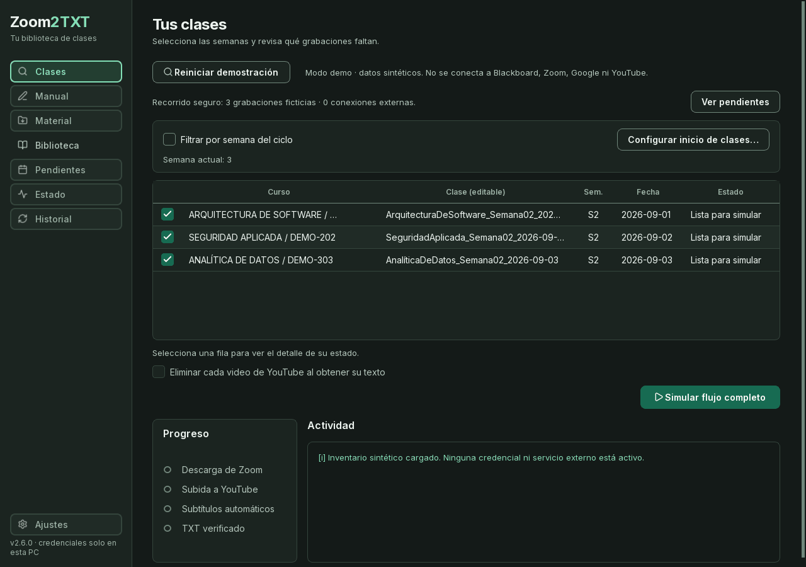
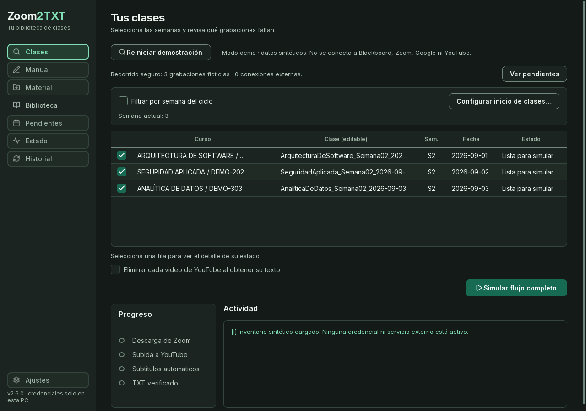
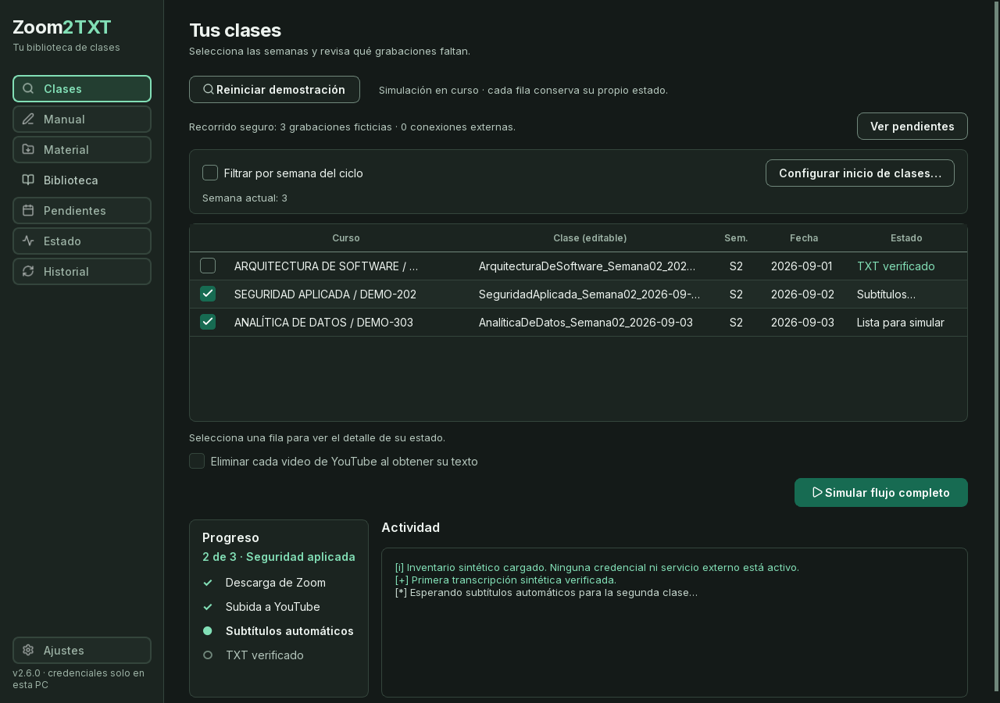
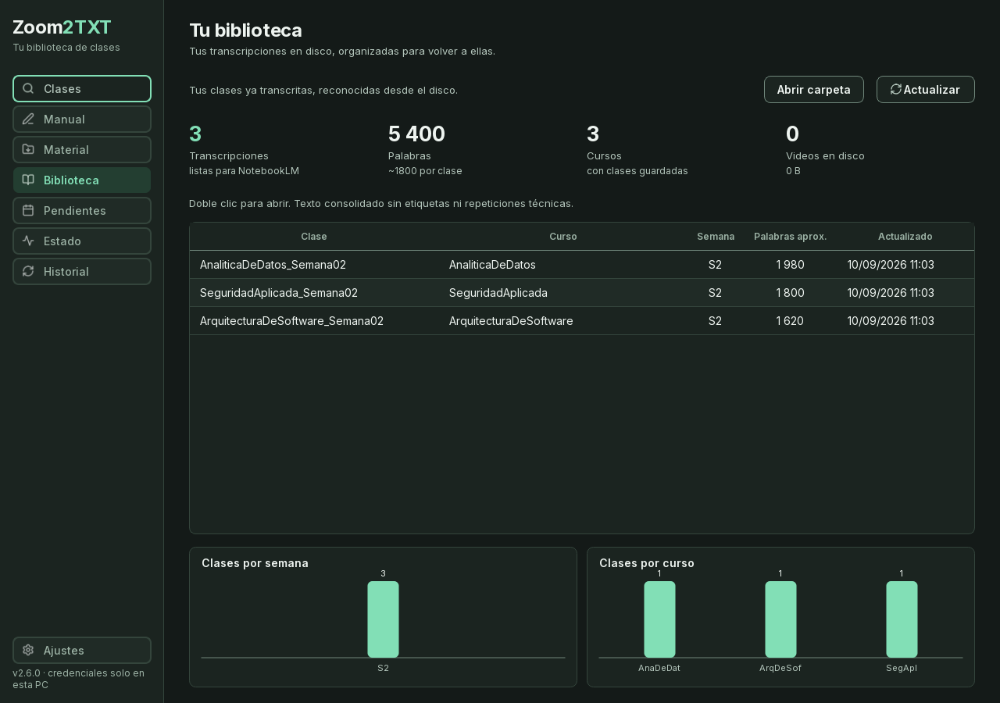
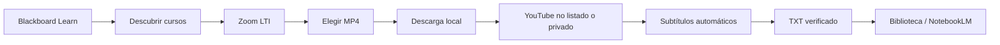

# Zoom2TXT

**Automatización de grabaciones académicas: Blackboard → Zoom → YouTube → TXT.**

[](https://github.com/MACOABC/Zoom2TXT/actions/workflows/ci.yml)
[](https://github.com/MACOABC/Zoom2TXT/actions/workflows/secrets.yml)


Zoom2TXT convierte un flujo académico repetitivo en una aplicación de escritorio guiada. Descubre cursos y grabaciones, selecciona el MP4 correcto, descarga en segundo plano, sube temporalmente a YouTube, espera los subtítulos automáticos y entrega un TXT organizado para NotebookLM.

> **Resultado observado en el flujo real del autor:** aproximadamente 15–18 interacciones manuales se reducen a búsqueda, revisión y confirmación; la intervención activa baja de unos 10–20 minutos a 1–3 minutos por clase. Son mediciones operativas personales, no un benchmark universal. Consulta la [metodología](docs/PORTFOLIO_METRICS.md).



## Qué demuestra el proyecto

- Integración de una aplicación Qt con Blackboard Learn Ultra, Zoom y YouTube Data API v3.
- OAuth por usuario, contraseñas en el keyring del sistema y archivos sensibles fuera del repositorio.
- Trabajos recuperables: una interrupción no obliga a descargar ni subir nuevamente lo ya confirmado.
- Detección de duplicados, selección del MP4 sobre audio separado y organización por curso/semana.
- Estados explícitos para descarga, subida, procesamiento de subtítulos y verificación del TXT.
- Una suite de **168 pruebas automatizadas** con HTTP real bloqueado durante los tests.

## Demo segura, sin credenciales

El modo demo utiliza cursos, grabaciones y transcripciones ficticias. No abre sesiones ni realiza peticiones a Blackboard, Zoom, Google o YouTube.

```powershell
python main.py --demo
```

La demostración permite revisar el inventario, simular el pipeline y abrir la biblioteca resultante. Todos sus archivos viven en un directorio temporal que se elimina al cerrar.







## Flujo



La tanda prepara primero todas las grabaciones admitidas sin esperar a los subtítulos de cada una. Luego consulta las transcripciones pendientes por turnos: una clase lenta no bloquea las demás. Pausar conserva los IDs confirmados y evita repetir subidas.

El video remoto se elimina obligatoriamente después de guardar y verificar el TXT. Si falla la eliminación, el trabajo queda pendiente y se reintenta al abrir la app y cada dos minutos mientras esté libre. Una carpeta de copia opcional desconectada no retrasa el borrado remoto. Las clases que aún no ofrecen subtítulos conservan su video para poder continuar; la eliminación requiere un TXT íntegro. La copia local del MP4 se controla por separado.

Cada etapa persiste solo el estado necesario para poder continuar. Antes de repetir una subida incierta, la app revisa el canal y conserva el trabajo cuando la respuesta no es concluyente.

La arquitectura y sus límites de confianza están descritos en [docs/ARCHITECTURE.md](docs/ARCHITECTURE.md).

## Tecnologías

| Área | Implementación |
|---|---|
| Escritorio | Python 3.12, PySide6, Qt WebEngine |
| Descarga | yt-dlp, sesiones autenticadas y reanudación |
| Transcripción | YouTube Data API v3 y subtítulos automáticos |
| Autorización | OAuth 2.0 por usuario |
| Secretos | Credential Manager / Secret Service / KWallet mediante `keyring` |
| Persistencia | SQLite, escrituras atómicas y `platformdirs` |
| Calidad | `unittest`, Ruff, pip-audit, Gitleaks y GitHub Actions |
| Distribución | PyInstaller |

## Instalación para desarrollo

```powershell
git clone https://github.com/MACOABC/Zoom2TXT.git
cd Zoom2TXT
python -m venv .venv
.\.venv\Scripts\Activate.ps1
python -m pip install -r requirements-dev.txt
python main.py --demo
```

En Linux, activa el entorno con `source .venv/bin/activate`. La versión publicada se valida principalmente en Windows; la lógica de rutas y almacenamiento es multiplataforma, pero el empaquetado Linux todavía requiere una release propia y pruebas de distribución.

Para usar cuentas reales, ejecuta `python main.py`. El asistente solicita:

1. La URL HTTPS del Blackboard de la institución.
2. El usuario de Blackboard y, opcionalmente, su contraseña para el formulario nativo; la contraseña va al keyring del SO. SSO, MFA o CAPTCHA se completan en la página del campus. La clave de una grabación de Zoom solo se necesita en modo manual, si el enlace la exige.
3. Un JSON OAuth de escritorio creado por el propio usuario. El asistente explica los seis pasos de Google Cloud, incluido agregar el propio correo como usuario de prueba aunque sea el creador del proyecto.
4. Autorización de su propia cuenta de YouTube y carpetas locales de trabajo.

`client_secrets.json`, `token.json`, cookies, configuraciones, videos y transcripciones se guardan en la carpeta de datos del usuario, no en el repositorio.

## Pruebas y controles

```powershell
python scripts/privacy_audit.py
python -m ruff check .
python -m unittest discover -s tests -q
python -m pip_audit -r requirements.txt
```

El CI repite esos controles en Windows y Ubuntu. Un segundo workflow inspecciona todo el historial con Gitleaks. La auditoría previa a publicación está documentada en [docs/SECURITY_AUDIT.md](docs/SECURITY_AUDIT.md).

Para presentar el proyecto sin exagerar sus resultados, consulta los [textos de portafolio](docs/PORTFOLIO_COPY.md), la [metodología de métricas](docs/PORTFOLIO_METRICS.md) y el [protocolo pendiente de pruebas con usuarios](docs/USER_TESTING.md).

## Compilar para Windows

El binario de Deno no se guarda en Git. El script siguiente descarga la versión fijada y verifica tanto el ZIP como el ejecutable mediante SHA-256 antes de compilar:

```powershell
python scripts/fetch_runtime.py --platform win-x64
python -m PyInstaller --noconfirm --clean zoom2txt.spec
```

El usuario final conserva `Zoom2TXT.exe` y `yt-dlp.exe` en la misma carpeta. Las releases binarias se publican por separado para evitar incluir ejecutables pesados en el historial Git.

## Privacidad y límites

- Cada persona usa sus propias credenciales; el proyecto no distribuye cuentas compartidas.
- El soporte automático depende de la estructura Learn Ultra + Zoom LTI expuesta por cada institución y puede requerir adaptación.
- La generación y disponibilidad de subtítulos dependen de YouTube.
- La app limita intencionalmente las clases nuevas iniciadas por día; las recuperaciones ya subidas pueden continuar.
- No se incluyen grabaciones, transcripciones, nombres de cursos, correos, IDs ni capturas de una cuenta real.
- El modo móvil y el control por Telegram no forman parte de esta versión pública.

## Estructura

```text
zoom2txt/
├── auth/            # keyring y credenciales locales
├── blackboard/      # cursos, Zoom LTI, materiales y calendario
├── cleaning/        # consolidación fiel de subtítulos
├── core/            # pipeline recuperable
├── download/        # integración con yt-dlp
├── gui/             # interfaz PySide6
└── transcription/   # OAuth, YouTube y subtítulos
tests/               # fixtures sintéticos; HTTP real prohibido
scripts/             # auditoría de privacidad, runtime y capturas demo
docs/                # arquitectura, métricas y seguridad
```

## Estado del proyecto

Zoom2TXT es una aplicación utilizada en un flujo académico real y presentada aquí como una versión de portafolio anonimizada. La siguiente deuda está declarada, no escondida: dividir `main_window.py`, completar el empaquetado Linux reproducible y ampliar pruebas end-to-end contra un entorno sandbox de Blackboard.

Consulta [CONTRIBUTING.md](CONTRIBUTING.md) antes de proponer cambios y [SECURITY.md](SECURITY.md) para reportar una vulnerabilidad sin publicar datos sensibles.

## Licencia

[MIT](LICENSE). Inter se distribuye bajo SIL Open Font License; los iconos Lucide conservan su licencia ISC/MIT en `assets/LICENSE.lucide.txt`; Deno conserva su licencia en `assets/runtime/`.
