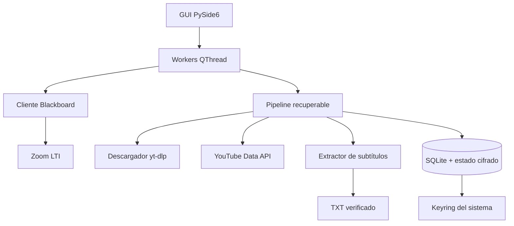

# Arquitectura

Zoom2TXT separa la interfaz de las integraciones y persiste cada transición crítica. La meta no es solo automatizar el camino feliz: es poder continuar después de cerrar la aplicación, perder conexión o encontrar una subida incierta.

## Componentes

### GUI

`zoom2txt/gui/` contiene navegación, wizard inicial, estados, biblioteca y recuperación. Las operaciones largas salen del hilo de interfaz mediante `QThread`.

### Blackboard y Zoom

`zoom2txt/blackboard/` consulta cursos y contenido con la sesión del WebEngine. El lanzamiento LTI de Zoom se valida antes de seguir redirecciones o descargar adjuntos. La selección distingue MP4 de audio independiente y, cuando existe más de una grabación de una clase, puede conservar la de mayor duración.

### Pipeline

`zoom2txt/core/pipeline.py` coordina el trabajo sin ocultar estados intermedios:

1. Verifica si ya existe un TXT íntegro.
2. Comprueba un ID de YouTube guardado o reconcilia una subida incierta.
3. Reutiliza un MP4 local cuyo hash coincide.
4. Descarga solo cuando no existe una copia válida.
5. Sube y guarda el ID antes de avanzar.
6. Espera subtítulos, consolida el texto y verifica el archivo.
7. Ejecuta la copia o limpieza solicitada únicamente después de confirmar el TXT.

### Persistencia

- `platformdirs` elige la carpeta de datos del usuario.
- SQLite guarda inventario, historial, estados y planificación.
- Los JSON con URLs o cookies se cifran ligados al usuario del sistema.
- La contraseña de Zoom reside en el keyring; no se serializa en configuración.
- Las escrituras importantes usan reemplazo atómico.

## Límites de confianza

| Límite | Medida |
|---|---|
| URL introducida por el usuario | HTTPS obligatorio, sin credenciales ni fragmentos |
| Lanzamiento LTI | Hosts esperados y redirecciones validadas |
| OAuth | Credencial de tipo `installed`, endpoints oficiales y token local |
| Descargas | Rutas confinadas, nombres seguros y comprobación de tamaño/hash |
| Recuperación | Una respuesta parcial nunca autoriza una copia nueva |
| Diagnósticos | Redacción de correos, tokens, cookies y parámetros sensibles |
| Respaldo | Excluye secretos y archivos académicos |

## Modo demo

`main.py --demo` crea un perfil temporal, carga tres cursos ficticios y reemplaza el procesamiento remoto por una simulación local. Las secciones que requieren cuentas están deshabilitadas. Al cerrar, el directorio temporal se elimina.

## Decisiones conscientes

- YouTube se utiliza por la calidad de sus subtítulos automáticos, no como almacenamiento permanente obligatorio.
- La reconciliación prefiere conservar un trabajo pendiente antes que arriesgar una subida duplicada.
- El TXT conserva las palabras producidas por YouTube; solo elimina estructura VTT y repeticiones técnicas.
- El límite diario de la app es una decisión operativa independiente de la cuota de Google.
